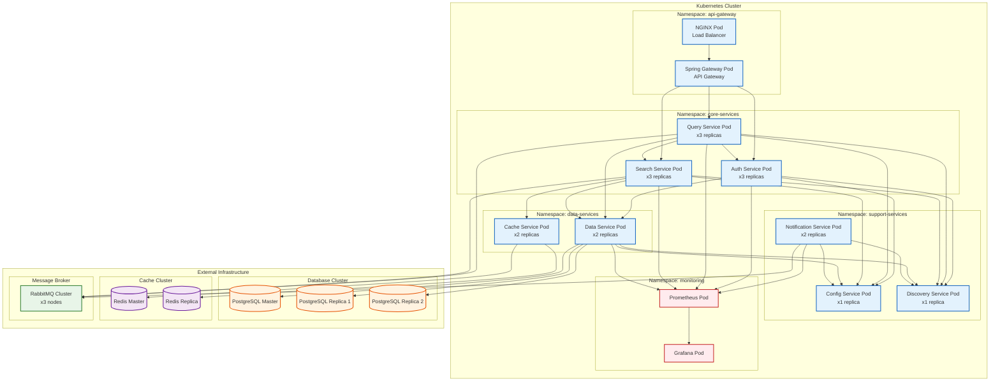
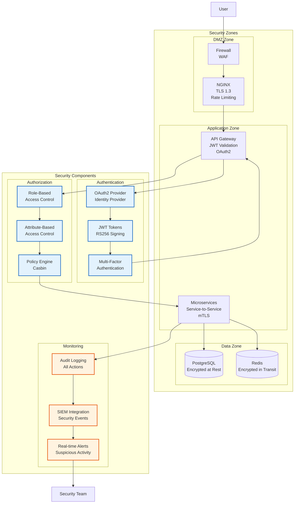

# Architecture Diagram - AI Search Engine

## System Architecture Overview

This diagram illustrates the complete microservices architecture of the AI Search Engine platform, showing service deployment, communication patterns, and infrastructure components.

```mermaid
graph TB
    subgraph "Client Layer"
        User[User/Web Client]
        Mobile[Mobile App]
        Admin[Admin Dashboard]
    end

    subgraph "Edge Layer"
        NGINX[NGINX Load Balancer<br/>TLS Termination<br/>Rate Limiting]
        SpringGateway[Spring Cloud Gateway<br/>API Routing<br/>Circuit Breaker]
    end

    subgraph "Application Layer - Microservices"
        subgraph "Core Services"
            AuthService[Auth Service<br/>JWT/OAuth2<br/>RBAC]
            QueryService[Query Service<br/>Request Validation<br/>Audit Logging]
            SearchService[Search Service<br/>AI Integration<br/>Result Processing]
        end

        subgraph "Data Services"
            DataService[Data Service<br/>PostgreSQL Sharding<br/>Data Encryption]
            CacheService[Cache Service<br/>Redis<br/>Response Caching]
        end

        subgraph "Support Services"
            NotificationService[Notification Service<br/>Event Processing<br/>Email/SMS]
            GatewayService[Gateway Service<br/>API Management<br/>Security]
        end

        subgraph "Infrastructure Services"
            ConfigService[Config Service<br/>Centralized Config<br/>Secrets Management]
            DiscoveryService[Discovery Service<br/>Service Registry<br/>Health Checks]
        end
    end

    subgraph "Messaging Layer"
        RabbitMQ[RabbitMQ<br/>Message Broker]
        Kafka[Kafka<br/>Event Streaming]
    end

    subgraph "Data Layer"
        subgraph "Primary Database"
            PostgreSQL1[(PostgreSQL Shard 1)]
            PostgreSQL2[(PostgreSQL Shard 2)]
            PostgreSQL3[(PostgreSQL Shard 3)]
        end

        subgraph "Cache Layer"
            Redis[(Redis Cluster<br/>In-memory Cache)]
        end

        subgraph "Search Index"
            Elasticsearch[(Elasticsearch<br/>Search Index)]
        end
    end

    subgraph "Infrastructure Layer"
        subgraph "Containerization"
            Docker[Docker<br/>Container Runtime]
            Kubernetes[Kubernetes<br/>Orchestration]
        end

        subgraph "Monitoring & Logging"
            Prometheus[Prometheus<br/>Metrics Collection]
            Grafana[Grafana<br/>Dashboards]
            ELK_Stack[ELK Stack<br/>Logging<br/>(Planned)]
        end

        subgraph "CI/CD"
            Jenkins[Jenkins<br/>CI/CD Pipeline]
            GitHub_Actions[GitHub Actions<br/>Automation]
        end
    end

    subgraph "External Services"
        AIProvider[AI Model Provider<br/>(Mocked)]
        EmailProvider[Email Service<br/>SMTP]
        SMSProvider[SMS Service<br/>Twilio]
    end

    %% Connections - Client to Edge
    User --> NGINX
    Mobile --> NGINX
    Admin --> NGINX
    NGINX --> SpringGateway

    %% Connections - Gateway to Services
    SpringGateway --> AuthService
    SpringGateway --> QueryService
    SpringGateway --> SearchService
    SpringGateway --> GatewayService

    %% Connections - Service to Service
    AuthService --> DataService
    QueryService --> AuthService
    QueryService --> DataService
    QueryService --> SearchService
    SearchService --> DataService
    SearchService --> CacheService
    SearchService --> AIProvider
    DataService --> PostgreSQL1
    DataService --> PostgreSQL2
    DataService --> PostgreSQL3
    CacheService --> Redis
    NotificationService --> DataService
    NotificationService --> EmailProvider
    NotificationService --> SMSProvider

    %% Connections - Infrastructure Services
    AuthService --> ConfigService
    QueryService --> ConfigService
    SearchService --> ConfigService
    DataService --> ConfigService
    NotificationService --> ConfigService
    GatewayService --> ConfigService

    AuthService --> DiscoveryService
    QueryService --> DiscoveryService
    SearchService --> DiscoveryService
    DataService --> DiscoveryService
    NotificationService --> DiscoveryService
    GatewayService --> DiscoveryService

    %% Connections - Messaging
    QueryService --> RabbitMQ
    SearchService --> RabbitMQ
    NotificationService --> RabbitMQ
    NotificationService --> Kafka

    %% Connections - Infrastructure
    AuthService --> Prometheus
    QueryService --> Prometheus
    SearchService --> Prometheus
    DataService --> Prometheus
    NotificationService --> Prometheus
    GatewayService --> Prometheus

    Prometheus --> Grafana

    %% Style Definitions
    classDef clientStyle fill:#e1f5fe,stroke:#01579b,stroke-width:2px
    classDef edgeStyle fill:#f3e5f5,stroke:#4a148c,stroke-width:2px
    classDef serviceStyle fill:#e8f5e8,stroke:#1b5e20,stroke-width:2px
    classDef dataStyle fill:#fff3e0,stroke:#e65100,stroke-width:2px
    classDef infraStyle fill:#fce4ec,stroke:#880e4f,stroke-width:2px
    classDef externalStyle fill:#f1f8e9,stroke:#33691e,stroke-width:2px

    class User,Mobile,Admin clientStyle
    class NGINX,SpringGateway edgeStyle
    class AuthService,QueryService,SearchService,DataService,CacheService,NotificationService,GatewayService,ConfigService,DiscoveryService serviceStyle
    class PostgreSQL1,PostgreSQL2,PostgreSQL3,Redis,Elasticsearch dataStyle
    class Docker,Kubernetes,Prometheus,Grafana,ELK_Stack,Jenkins,GitHub_Actions,RabbitMQ,Kafka infraStyle
    class AIProvider,EmailProvider,SMSProvider externalStyle
```

## Deployment Architecture



## Security Architecture



## Key Architecture Patterns

### 1. Microservices Pattern
- Each service has a single responsibility
- Independent deployment and scaling
- Service isolation for fault tolerance

### 2. API Gateway Pattern
- Single entry point for all client requests
- Request routing, composition, and protocol translation
- Cross-cutting concerns (security, monitoring, rate limiting)

### 3. Service Discovery Pattern
- Dynamic service registration and discovery
- Load balancing and health checks
- Configuration management

### 4. Event-Driven Pattern
- Asynchronous communication via message brokers
- Loose coupling between services
- Event sourcing and CQRS capabilities

### 5. CQRS Pattern
- Command Query Responsibility Segregation
- Separate read and write models
- Optimized for different access patterns

### 6. Sharding Pattern
- Horizontal scaling of databases
- Data distribution across multiple nodes
- Improved performance and availability
