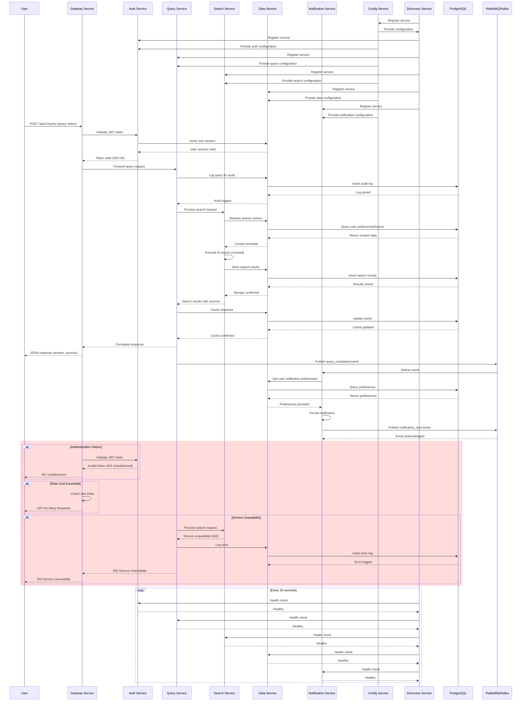

# Event Diagram - AI Search Engine

## Event Flow Overview

This diagram illustrates the sequence of events and interactions between microservices when processing a user query in the AI Search Engine platform.

## Key Event Types

### 1. Service Registration Events
- `service_registered`: When a service registers with discovery
- `configuration_updated`: When service configuration changes

### 2. User Query Events
- `query_received`: When a user query is received
- `query_validated`: After authentication and validation
- `query_processed`: After search execution
- `query_completed`: After response generation

### 3. Data Events
- `audit_log_created`: When audit logs are created
- `search_results_stored`: When search results are persisted
- `cache_updated`: When response cache is updated

### 4. Notification Events
- `notification_triggered`: When notifications need to be sent
- `notification_sent`: After successful notification delivery

### 5. Security Events
- `authentication_success`: Successful user authentication
- `authentication_failure`: Failed authentication attempts
- `authorization_denied`: When access is denied
- `rate_limit_exceeded`: When rate limits are hit

## Event Flow Characteristics

### Synchronous Flow
- User query processing follows a synchronous request-response pattern
- Each service validates and processes before passing to the next
- Fail-fast approach with proper error handling

### Asynchronous Flow
- Notifications and background processing use message brokers
- Event-driven architecture for loose coupling
- Guaranteed delivery and retry mechanisms

### Security Flow
- Every service-to-service call is authenticated
- Zero-trust security model implemented
- Comprehensive audit logging for all events

### Monitoring Flow
- Health checks ensure service availability
- Metrics collection for performance monitoring
- Distributed tracing for request correlation
